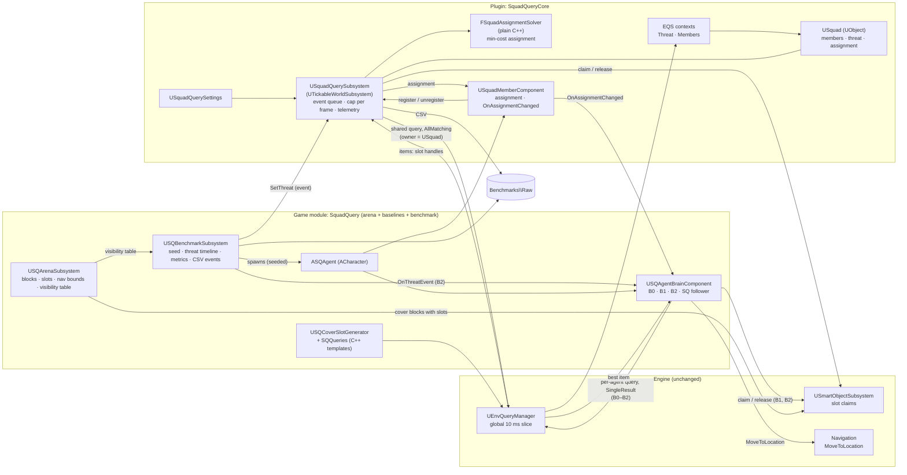

# 02 · System Architecture: SquadQuery (v1.0, final)

**Phase:** 3 (Architecture), **final**, 2026-11-21. It replaces the one-paragraph plan in the README; the changes are listed in §13.
**Engine:** UE 5.8.4. Every engine behaviour relied on here is verified in [01b_Research_Findings.md](01b_Research_Findings.md); references like `01b #3` point to its §1 table.
**Rule:** this is the design *before* code (Phase 3). If implementation proves a decision wrong, this file is updated in the same step.

---

## 1. Goals and non-goals

**Goals**
1. Evaluate the agent-independent part of a cover decision (is this slot hidden from the threat? far enough from it?) **once per squad**, with the engine's own EQS.
2. Add a **cheap per-agent score** (distance to the slot) outside EQS.
3. Assign slots to the squad **jointly and without conflicts**: minimum total cost, at most one agent per slot, never a slot held by another squad.
4. Re-evaluate **only on events** (the threat moved, a member joined or left, a member lost its slot), never by polling, and cap how many squad evaluations start per frame.
5. Run three per-agent baselines and SquadQuery **in the same build, on the same arena, with the same queries**, switched by a command-line value.
6. Keep the core reusable (a plugin), its assignment algorithm **testable without a world**, and its EQS query **replaceable by any designer-authored `UEnvQuery`**.

**Non-goals (v1)**
- Generating cover points (solved elsewhere, `01b` #13). The arena places them.
- Perception (`01b` #14). The threat is a scripted squad event.
- Several threats, destructible cover, squad roles (suppressor, flanker). Growth paths, §11.
- Mass entities (that is UE5-StateHandoff's area).
- Network replication.

## 2. The core idea in plain words

When the threat moves, a per-agent setup asks eight questions: "where should *I* hide?" Each soldier generates nearby slots, traces each candidate from the threat, scores by distance, and picks. SquadQuery asks one question per squad: "which slots near *any* of us are safe?" Then it decides who goes where.

```text
Per squad, on an event:
  1. Shared:    EQS (AllMatching) over the union of the members' nearby slots
                filters: hidden from the threat, at least 8 m from it        → candidate slots C
  2. Personal:  cost(i, j) = distance(agent i, slot j)
                           − KeepCurrentBonus   if j is agent i's current slot
                forbidden   if slot j is claimed by someone outside the squad
  3. Joint:     choose one slot per agent, no slot twice, minimum total cost  (assignment problem)
  4. Apply:     release old claims, claim new slots (Smart Objects), notify members → MoveToLocation
```

**Why minimum total cost, solved exactly.** This is the classic assignment problem. The Hungarian method (Kuhn 1955, Munkres 1957) solves it exactly; in its shortest-augmenting-path form it costs O(n²·m) for n agents and m candidates, which at n = 8 and m ≈ 100 is a few thousand operations. Greedy claiming, which is what per-agent queries plus Smart Object claims produce, has no optimality guarantee. Exactness also makes the solver testable: its total must equal brute force on small cases (SC7).

**Rejected alternatives for step 3:**

| Alternative | Why we rejected it |
|---|---|
| Greedy (each agent takes its nearest free slot, in some order) | The order decides the outcome; one agent's choice can force a squadmate across the squad. Kept only as a measured ablation (`sq.Solver=Greedy`, Phase 8) |
| Auction algorithm | Also near-optimal, but needs an ε parameter to tune, and its result depends on it. Hungarian is exact and fast enough at this size |
| Minimise the worst travel (bottleneck assignment) | A valid objective that would favour p95 time-to-cover. Min-sum is the textbook default and easier to test; bottleneck is a growth option, decided with data |
| A per-frame utility system with influence maps | Exists already (TCAT, Wise Feline: `research/03` §10); doesn't answer the conflict question |

## 3. Modules and where they live

```text
D:\UNREAL PORTFOLIO\P07_SquadQuery\SquadQuery\              ← the UE project
├── SquadQuery.uproject                                      (plugins: SquadQueryCore, SmartObjects)
├── Source\SquadQuery\{Public,Private}\                      ← game module: arena, agents, baselines, benchmark
├── Plugins\SquadQueryCore\Source\SquadQueryCore\{Public,Private}\   ← the reusable system
└── Config\  Content\
D:\UNREAL PORTFOLIO\P07_SquadQuery\Tools\                    ← build/package/smoke scripts; Python stats + run scripts
```

| Module | Type | Responsibility | Depends on |
|---|---|---|---|
| `SquadQueryCore` (plugin) | Runtime | Squads, shared evaluation, assignment solver, claims, event policy, EQS contexts, settings, telemetry | `Core`, `CoreUObject`, `Engine`, `AIModule`, `SmartObjectsModule`, `GameplayTags`, `DeveloperSettings` (each added in the step that first uses it) |
| `SquadQuery` (primary game module) | Game | Arena builder, cover blocks, agents and their brains (the three baselines and the SQ follower), query templates, benchmark director | `SquadQueryCore`, `AIModule`, `SmartObjectsModule`, `NavigationSystem`, `GameplayTags` (S1: the Smart Object types it constructs contain tags) |
| `Tools\` | Batch + Python | Build, package, smoke; CSV statistics; interleaved, CPU-pinned run orchestration | — |

**The dependency rule:** game → plugin, never the reverse. The plugin knows nothing about the arena, the baselines or the benchmark. It needs only: squad members (a component), a threat location per squad, and a `UEnvQuery` whose items carry Smart Object slot handles.

**Why the SmartObjects plugin is a declared dependency of the core** (`SquadQueryCore.uplugin` "Plugins"): the core claims slots through `USmartObjectSubsystem`. Declaring it makes UBT and the editor enable it with the core, instead of failing at link time in a project that forgot it (`01b` §3: the plugin is off by default).

## 4. Classes

### 4.1 Plugin `SquadQueryCore` (7 pieces, each with a reason)

| Class | Kind / base | Responsibility | Why it exists, and what we rejected |
|---|---|---|---|
| `FSquadAssignmentSolver` | Plain C++ struct (no UObject) | Minimum-cost assignment for an n × m cost matrix: forbidden pairs, n > m handled by "no slot" columns, returns the slot per agent and the total | **Unit-testable against brute force without a world** (SC7). *Rejected:* the algorithm inside the subsystem, testable only in a running world |
| `USquad` | `UObject` (outer: the subsystem) | One squad: its members, its threat location, the current assignment (slot per member), a generation counter, the id of its query in flight | EQS needs a **UObject owner** for a query (`01b` §2), and the contexts must find the squad from that owner. GC sees its member pointers. *Rejected:* a squad id in an EQS named parameter (named params are floats; an id hidden in float bits is fragile) |
| `USquadQuerySubsystem` | `UTickableWorldSubsystem` (Game and PIE only) | Registry of squads; `SetThreat`; the event queue (dirty squads); starting shared queries, at most `MaxEvaluationsPerFrame` per frame; handling results (candidates → cost matrix → solver → claims → notify); CSV telemetry | Its lifetime is the world, and its `Tick` is the natural place to drain the event queue once per frame. *Rejected:* a manager actor (can be deleted or duplicated); a game-instance subsystem (outlives worlds) |
| `USquadMemberComponent` | `UActorComponent`, no tick | On each agent: squad id, registration in `BeginPlay`/`EndPlay`, the current assignment (slot handle, location, claim handle), `OnAssignmentChanged` (native and Blueprint delegate) | A component attaches to any pawn, Blueprint pawns included, and owns the per-agent data. *Rejected:* an interface (every pawn class would re-implement the bookkeeping) |
| `USquadQueryContext_Threat` | `UEnvQueryContext` | The threat location of the querier's squad. The querier is a `USquad` (shared query) or an actor with a member component (per-agent query) | **Every configuration reads the threat through this one context**, so the input is identical |
| `USquadQueryContext_Members` | `UEnvQueryContext` | The locations of all members of the querying `USquad` | With the Smart Object generator's multi-origin support, the squad's candidate set is **exactly the union** of the members' per-agent candidate sets (`01b` #10). *Rejected:* a squad-centre point with a bigger box (a different candidate set, so an unfair comparison) |
| `USquadQuerySettings` | `UDeveloperSettings` (`config=Game`, `defaultconfig`) | `MaxEvaluationsPerFrame`, `KeepCurrentBonusCm`, `SharedScoreWeightCm`, `ClaimPriority` | One designer-editable place, shown in Project Settings. *Rejected:* `UDeveloperSettingsBackedByCVars`, whose cvar sync is editor-only (UE5-UpdateBudget `01b` #11) |

**Console variables** (`ECVF_Default`, so they can be set from the command line and from config, UE5-UpdateBudget `01b` #11): `sq.Debug` (draw assignments), `sq.Solver` (`Optimal` / `Greedy`, Phase 8 ablation).

**Telemetry:** a CSV category `SquadQuery` with per-frame counts (`Evaluations`, `QueriesStarted`, `QueriesFinished`, `ItemTests`, `Assignments`, `Switches`, `ClaimFailures`, `SolveUs`) and **one exclusive timing stat, `SquadQueryDecide`**, wrapped around every piece of decision code (§9). Counters are plain fields published once per frame, because a CSV stat call per event would itself cost time (UE5-UpdateBudget measured about 50 ns per `CSV_CUSTOM_STAT`).

### 4.2 Game module `SquadQuery` (9 pieces)

| Class | Base | Responsibility |
|---|---|---|
| `USQArenaSubsystem` | `UWorldSubsystem` (Game/PIE) | In `OnWorldBeginPlay`, from the seed: the floor (an `AStaticMeshActor`), 100 cover blocks, one runtime `USmartObjectDefinition` with 6 slots, the navigation bounds volume (box body set from code, `01b` #9), and the 10 threat positions. It then waits for the navigation system's build-finished event; **ready** = a build has finished, nothing else is queued, and a corner-to-corner path is complete (changed in S1: "not in progress" alone is true before any build has been queued, and the event alone also fires for a near-empty build, `01b` #20). A one-shot timer fails the arena after 60 s of real time. When ready it fills the slot handles, traces the **visibility table** (threat position × slot → hidden?) once, before agents exist, and broadcasts `OnArenaReady`. `-SQArenaCheck` runs the S1 self-check and quits with exit code 0 or 1 |
| `ASQCoverBlock` | `AActor` | An unscaled root, a cube mesh scaled on its own component to 3.0 × 1.0 × 1.3 m (`BlockAll`), and a `USmartObjectComponent`. The root stays unscaled because slot offsets are relative to the actor (S1). Spawned deferred so the definition is set before `BeginPlay` registers it (`01b` #11) |
| `USQCoverBehaviorDefinition` | `USmartObjectBehaviorDefinition` | *Added in S1.* An empty behavior type for cover slots. A Smart Object definition is valid only if every slot has a behavior definition (`01b` #19); without it no block would register |
| `ASQAgent` | `ACharacter` | Capsule, character movement (450 cm/s, RVO avoidance since S2), a cylinder mesh for visibility, a `USquadMemberComponent` and a `USQAgentBrainComponent`. Possessed by a plain `AAIController` |
| `USQAgentBrainComponent` | `UActorComponent` | The decision logic in four modes (§9): **B0** polled per-agent query; **B1** + claims; **B2** event-driven + claims; **SQ** follows `OnAssignmentChanged`. Every mode ends in the same "set target" function, which owns the switch counter and `MoveToLocation`; B1/B2 claim in the query handler just before it (S3) |
| `USQCoverSlotGenerator` | `UEnvQueryGenerator_SmartObjects` | Sets the engine generator's protected settings (origin context, box half-extent, `bOnlyClaimable`) from code (`01b` #17). Every query in every configuration uses it, so the item source is identical |
| `SQQueries` | free functions (`SQQueries.h/.cpp`) | Build the two `UEnvQuery` templates in C++ (§7). *Rejected:* assets, which would be binary, unreviewable in a diff, and easy to drift between configurations |
| `USQBenchmarkSubsystem` | `UTickableWorldSubsystem` (Game/PIE) | The director: reads `-SQ…=` values; spawns squads from the seed once navigation is ready; runs the threat timeline; fires `BenchStart`/`BenchEnd`; writes CSV metadata; measures conflicts, switches, oscillations, time-to-cover (with the distance walked) and exposure from the visibility table (no traces); writes the per-agent and per-event run report |
| `ASQGameMode` | `AGameModeBase` | *Added in S2.* The default game mode with no player pawn, so the template map's `PlayerStart` puts no colliding `ADefaultPawn` among the agents and the director's camera stays the view target (`05` C2b) |

## 5. Overview diagram



## 6. Flow of one threat event in SQ mode

```mermaid
sequenceDiagram
  participant BD as USQBenchmarkSubsystem
  participant S as USquadQuerySubsystem
  participant E as UEnvQueryManager (tickables)
  participant P as FSquadAssignmentSolver
  participant SO as USmartObjectSubsystem
  participant M as USquadMemberComponent
  participant B as USQAgentBrainComponent
  BD->>S: SetThreat(Squad, Location) for each squad
  S->>S: mark squad dirty (queue, once per squad)
  Note over S: next Tick: start ≤ MaxEvaluationsPerFrame squads
  S->>E: PrepareQueryInstance(shared query, owner = USquad, AllMatching) → RunQuery
  Note over E: time-sliced with every other query (10 ms/frame, breadth first)
  E-->>S: finished (TSharedPtr<FEnvQueryInstance> kept by S)
  S->>S: drop if stale (squad generation changed)
  S->>S: candidates = items; cost(i,j) = distance − keep bonus; forbid slots claimed outside the squad
  S->>P: Solve(cost, n, m)
  P-->>S: slot per member (or none)
  S->>SO: MarkSlotAsFree(old) · MarkSlotAsClaimed(new)
  S->>M: SetAssignment(slot, location)
  M-->>B: OnAssignmentChanged
  B->>B: SetTarget → MoveToLocation (synchronous path query)
```

**Baselines, for contrast:** in B0/B1 each brain ticks every 0.5 s ± 0.1 s and runs its own `SingleResult` query; in B2 each brain runs its query when the director calls `OnThreatEvent`. The result handler applies the keep-current rule (§7), claims in B1/B2 (a failed claim re-queries next frame), then calls the same `SetTarget`.

### The per-frame order

| Where | What runs | Group |
|---|---|---|
| Brains (B0/B1 only) | Poll ticks that are due start queries | `TG_PrePhysics`, interval 0.5 s, seeded phase |
| Character movement, path following | Engine | tick groups as usual |
| `UEnvQueryManager::Tick` | EQS steps for every running query; finish callbacks (brains or the subsystem) | tickables (after `TG_PostPhysics`) |
| `USquadQuerySubsystem::Tick` | Drain the event queue (≤ cap), publish CSV counters | tickables |
| `USQBenchmarkSubsystem::Tick` | Threat timeline; metrics from the visibility table; CSV events | tickables |

The order among tickables isn't guaranteed by the engine **[inferred]**. Nothing here depends on it: an event raised after the EQS tick is simply served next frame, the same way in every configuration.

## 7. The queries, defaults and why

**The two query templates** (built in `SQQueries`, identical tests and thresholds):

| | Per-agent (B0, B1, B2) | Shared (SQ) |
|---|---|---|
| Generator | `USQCoverSlotGenerator`, origin = querier, box half-extent 15 m × 15 m × 2 m, `bOnlyClaimable = true` (engine default) | same generator, origin = `USquadQueryContext_Members`, same half-extent, `bOnlyClaimable = false` **and** the request filter's `bShouldIncludeClaimedSlots = true` (the squad must see its own claimed slots; the filter excludes claimed slots by default, `01b` #18) |
| Test 1 | Trace from `USquadQueryContext_Threat` (+170 cm) to item (+90 cm), Visibility channel, **filter: must hit** (hidden) | same |
| Test 2 | Distance item ↔ threat, **filter: ≥ 800 cm** | same |
| Test 3 | Distance item ↔ querier, **score**: closer is better | — (the personal score is the solver's cost) |
| Run mode | `SingleResult` (the engine's shortcut stays on, `01b` #3) | `AllMatching` |

**Defaults:**

| Setting | Default | Reasoning |
|---|---|---|
| Poll interval (B0, B1) | 0.5 s ± 0.1 s, seeded | The engine's Behavior Tree service default (`01b` #16) |
| EQS slice | 10 ms/frame, breadth first | Engine default, restated in `DefaultGame.ini` (`01b` #2). Every configuration runs under it |
| Query box half-extent | 15 m × 15 m × 2 m | About three cover blocks in each direction (12 m grid), so every agent sees several hidden slots. Same box per agent and per member in the squad union |
| Minimum distance to the threat | 8 m | Don't hide right next to the shooter |
| Heights | threat eye 170 cm, slot 90 cm, block 130 cm | A crouched soldier behind a 1.3 m block is hidden from a standing shooter |
| `KeepCurrentBonusCm` | 300 | A valid slot is given up only for one at least 3 m closer. **The same rule in every configuration**: the per-agent baselines check their current slot with one trace before switching (counted as an item test); SQ gets it as a cost bonus |
| `MaxEvaluationsPerFrame` | 4 | 16 squads start within 4 frames (67 ms at 60 fps). Caps the event-frame spike (H6). Swept 1 / 4 / 16 in Phase 8 |
| `SharedScoreWeightCm` | 1000 | If a designer adds *scoring* tests to the shared query, a slot's normalised EQS score enters the cost at this weight. The benchmark query only filters, so every candidate has the same score and the term has no effect |
| `ClaimPriority` | `Normal` | No preemption between agents, so claims behave the same in B1, B2 and SQ |
| MoveTo acceptance radius / "in cover" radius | 50 cm / 75 cm | Arrive at the slot; count as in cover a little outside it, because capsules jostle |
| Squad size | 8 | A common squad size in shooters; 128 agents = 16 squads |

## 8. Lifetime and safety rules

| Risk | Rule | Evidence |
|---|---|---|
| Subsystems also exist in editor worlds | `DoesSupportWorldType`: Game and PIE only | UE5-UpdateBudget `01b` #2 |
| A query finishes after its owner (agent or squad) is gone | Finish delegates are bound with `CreateUObject` (weak); owners abort their query in `EndPlay` / `Deinitialize`; EQS also marks owner-lost queries (`EnvQueryInstance.cpp:294-298`) | `01b` §2 |
| A shared result arrives after the threat moved again, or after membership changed | Every squad has a generation counter, bumped by each event; a result with an old generation is dropped and the squad stays dirty | design |
| A member is destroyed between query and result | The result handler maps members from the squad's current list; missing members are skipped; the squad is re-marked dirty | design |
| A claim held by a destroyed agent | `EndPlay` releases its claim (agents) and `USquad` releases claims of members that leave | `01b` #7 (agents must release their own slots) |
| Two squads compete for one slot | Assignment and claiming happen in the same game-thread handler, after a `CanBeClaimed` check, so a claim made by SQ can't lose a race **[inferred]**. Any failure is counted and the squad re-evaluates | `01b` #7, #8 |
| A per-agent claim races (B1, B2) | Expected (H5). Counted; the agent re-queries next frame | `01b` #8 |
| Navigation not ready when agents spawn | Agents spawn only after `OnArenaReady`, whose rule is in §4.2 (`USQArenaSubsystem`); the arena logs the build time | `01b` #9, #20 |
| The runtime Smart Object definition is collected | The arena subsystem holds it in a `UPROPERTY` | GC basics |
| A StateTree event queue overflows (S8 adapter) | One event per assignment change, never per frame (cap 64) | `01b` #12 |
| Smart Object subsystem isn't thread-safe | Everything runs on the game thread | `01b` §3 |

## 9. One logic path for every configuration

The workload must be identical across B0–B2 and SQ, so **every configuration ends in the same `SetTarget(slot)`** on the brain, which owns the switch counter and the one `MoveToLocation` call. The claim is made just before it: by the brain's query handler in B1/B2 (a failed claim re-queries instead of calling `SetTarget`), by the subsystem in SQ. Only *how the slot is chosen* differs.

| Config | Who chooses | When | Exclusivity |
|---|---|---|---|
| B0 | The agent's own `SingleResult` query | Poll tick every 0.5 s ± 0.1 s | none |
| B1 | The same | Poll tick | Smart Object claim of the pick; failure → re-query next frame |
| B2 | The same | After a threat event; after a failed claim | Smart Object claim |
| SQ | The squad's shared query + solver | After a squad event (≤ 4 squads started per frame) | Smart Object claims made by the subsystem |

**Measuring at equal cost.** The exclusive stat `SquadQueryDecide` wraps the brain's poll and result handling, the subsystem's tick and result handling, the solver, every claim and every `MoveToLocation`, in all modes. The engine's path query inside `MoveToLocation` records into its own exclusive `Pathfinding` stat, so **AI time = `EnvQueryManager` + `SquadQueryDecide` + `Pathfinding`**, summed per frame (S2; `05` C5). A move that path following ends short of its slot is retried from the engine's finished-move event, the same way in every mode (`05` C3). Metrics (conflicts, switches, time-to-cover) are computed by the director from per-agent fields and the precomputed visibility table, in its own CSV scope `SQBench`, which is **excluded** from AI time and identical in every mode.

## 10. C++ vs Blueprint

| C++ | Blueprint |
|---|---|
| Everything measured: solver, subsystem, squad, member component, contexts, arena, brains, director | `OnAssignmentChanged` is `BlueprintAssignable`, so a Blueprint pawn can react to assignments; settings in Project Settings; the shared query can be any designer-authored EQS asset |

## 11. How it grows into a production game (not built now)

- **StateTree** (step S8): the member component sends one `SendStateTreeEvent` (tag `SquadQuery.AssignmentChanged`, payload = slot location) per change, so a sleeping StateTree wakes only when its orders change (`01b` #12).
- **Several threats**: the threat context returns several locations; the trace test's multiple-context filter (`MultipleContextFilterOp`) decides "hidden from all".
- **Roles**: the cost matrix gets per-role terms (a suppressor wants line of sight, a flanker wants an angle). Same solver.
- **Share across squads**: in the benchmark all squads face one threat, so a per-event cache of slot visibility would let squads share traces. Measured first; only valid when squads share a threat.
- **Cheaper personal score**: path length from a single nav query per agent (one Dijkstra-like search) instead of straight-line distance.
- **Async traces** (`01b` §3): move visibility traces off the game thread at one frame of latency.
- **Dedicated server**: nothing here renders; the system runs unchanged on a server. Replication of assignments is not needed (movement replicates).
- **Budgeting**: run squad evaluations through a frame-time budget (UE5-UpdateBudget's scheduler) instead of a fixed count per frame.
- **Gameplay Debugger category** for squads, next to the engine's Smart Object category.

## 12. Known limits (stated, not hidden)

1. **Sharing may not beat an event-driven per-agent baseline on CPU** (H2). The per-agent shortcut traces only until the first hidden slot; the shared query traces every candidate. We measure and report it.
2. **Event-driven work arrives in bursts.** The per-frame cap trades a few frames of latency for a lower p99. SC2 and SC6 check both sides.
3. **Straight-line personal score.** Same error in every configuration (`01` §8).
4. **Development-build EQS debugger overhead** is per finished query, and part of it grows with the number of query owners (`01b` #22): per-agent configurations pay it N times as often, and with N owners each time. It favours SQ, can't be compiled out with the launcher engine (no Test build), and isn't switched off by `bDebuggingInfoEnabled`. Phase 8 measures it from its own cycle stats (`EQS Debug StoreQuery`, `EQS Debug StoreStats`) and reports AI time with and without it (`01b` #6).
5. **The solver is O(n²·m) per squad.** Fine for squads of 8–16; a 200-agent "squad" would need a different design.
6. **Decisions aren't bit-identical across runs** (wall-clock EQS slice, `01b` B-1). All decision metrics are distributions over runs.

## 13. Changes from the plan (README, 2026-11-20 → v1.0)

| Change | Why |
|---|---|
| "Cost is agents × items × tests" corrected: single-result queries short-circuit the expensive filter | `01b` #3. New hypothesis H2; the squad's candidate set is the union of members' sets, no larger |
| Positioned as a **measured, engine-native implementation of a known idea**, not a new idea | `01b` #13 (2014 forum design; F.E.A.R.) |
| Smart Object claims are both a baseline (B1, B2) and SquadQuery's cross-squad exclusivity | They are the engine's existing answer (`01b` #7) |
| A third baseline, **B2 (event-driven per-agent + claims)** | Separates the effect of events from the effect of sharing; without it, any gain could be "just events" |
| **Optimal assignment** (Hungarian), greedy kept as an ablation | Exact, cheap at n = 8, testable (SC7) |
| StateTree events moved to an adapter step (S8) | StateTree needs an authored asset; the measured brain is C++ and identical in every configuration (`01b` #12, §8) |
| Perception removed from the measured loop | Its latency grows with N in every configuration (`01b` #14) |
| Arena built in code: runtime Smart Object definition, runtime nav bounds volume, `RuntimeGeneration=Dynamic` | No authored map or assets; seeded and reviewable (`01b` #9, #11) |
| `MaxEvaluationsPerFrame` cap | Event bursts (H6) |
| Every timed run pinned to the performance cores (the run script pins itself; each directly launched game inherits the mask) | Hybrid CPU (`01b` B-2) |
| **S1:** `USQCoverBehaviorDefinition` added; the block's root stays unscaled; navigation readiness also requires a complete corner-to-corner path; the floor is an `AStaticMeshActor`; `-SQArenaCheck` self-check | Smart Object validation (`01b` #19); slot offsets are relative to the actor; "no build in progress" is true before a build is queued; the floor needs no class of its own; the cooked-build proof of `03` S1 |
| **S1:** the shared query's request filter must include claimed slots | The filter excludes them by default (`01b` #18) |
| **S1:** readiness waits for the navigation system's build-finished event (plus the path test) instead of polling; the bounds volume calls `UpdateBounds()` after it gets its box | The review found the engine event (`05` B5); the self-check then found that the volume's cached bounds were empty and that the event also fires for a near-empty build (`01b` #20, `09` S1-c) |
| **S3:** SC2 is checked on the event frames too (p99.9 and the event-window maximum), not only on p99 | B2's event frames reach 8.35 ms at N = 128 while its p99 is 0.05 ms: event windows are under 1% of the frames (`09` S3) |
| **S3:** B1/B2 claim in the brain's query handler, not in `SetTarget` | A failed claim must re-query without changing the target; `SetTarget` stays the single path to movement |
| **S3:** the EQS debugger's per-query cost scales with the number of owners | Found in the S3 review (`01b` #22); limit 4 in §12 and the Phase 8 plan updated |
| **S2:** AI time also includes the engine's `Pathfinding` exclusive stat | `MoveToLocation`'s path query opens its own exclusive scope inside ours; without it, configurations that switch often would look cheaper (`05` C5, `07` S2) |
| **S2:** a ninth game-module piece, `ASQGameMode` (no player pawn) | The template map's `PlayerStart` would otherwise put a colliding default pawn among the agents (`05` C2b) |
| **S2:** one "valid cover" rule, `USQArenaSubsystem::IsValidCover`, and one 8 m constant | The self-check, the metrics and (from S3) the queries must agree on what counts as cover (`05` B4) |
| **S2:** agents use RVO avoidance | Path following plans around blocks, not agents; without avoidance 6% of agent-events ended short of cover with agents pushed against each other (`09` S2-a) |
| **S2:** lost moves are retried from `OnRequestFinished` | A retry that waited for the next decision would depend on how often each configuration decides (`05` C3) |
| **S1:** the game module also depends on `GameplayTags` directly | It constructs Smart Object request filters and slot definitions, which contain tag containers; the link failed without it (`09` S1-b) |
