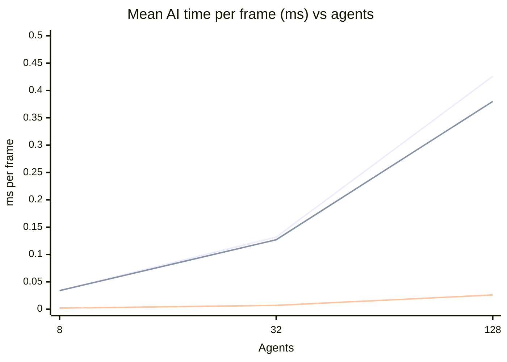
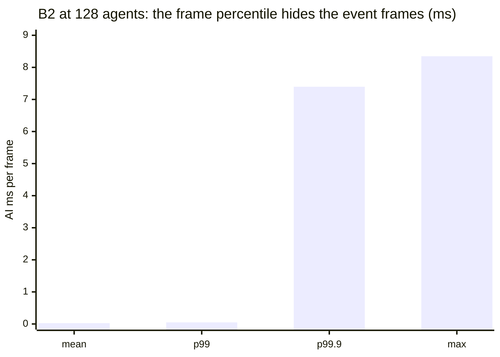

# P07 · SquadQuery: shared tactical decisions for squads

**Author:** Krish Gangani · [github.com/KrishGangani](https://github.com/KrishGangani)

**Domain:** AI decision-making at scale · **Difficulty:** ★★★½☆ · **Engine:** UE 5.8.4

> **Status: closed at step S4 of 8 (2026-11-21), by the owner's decision.** Built and measured: the runtime arena (packaged-build proof), the benchmark harness, the **three per-agent baselines B0, B1, B2** (captured at 8 / 32 / 128 agents, 3 runs each) and the **exact assignment solver** (tested against brute force). **Not built into the game: SquadQuery's shared squad evaluation (S5)**, so the comparison it was designed for (SC1–SC6) is **not measured**. Every number below comes from a packaged Development run or a unit test; nothing is estimated.

| Phase | 1 Problem | 2 Research | 3 Architecture | 4 Foundation | 5 Implementation | 6–10 |
|---|---|---|---|---|---|---|
| State | ✓ | ✓ | ✓ final | ✓ | S1–S4 ✓; S5–S8 not built | docs for S1–S4; 10, 12 written |

---

## Problem statement

When a squad of eight comes under fire, each soldier usually runs **its own** EQS cover query. The question "can the threat see this cover slot?" has the same answer for every squadmate, yet each one traces it again, and polled queries repeat it when nothing has changed. All queries share one engine time slice (10 ms per frame by default), so at high agent counts answers arrive late. Squadmates also choose independently, so neighbours pick the same slot. Smart Object claims stop two soldiers *holding* one slot, but the first caller wins, and the loser queries again. Details: [Explanation/01_Problem_Analysis.md](Explanation/01_Problem_Analysis.md).

**Corrected after reading the 5.8.4 source** ([01b](Explanation/01b_Research_Findings.md)):
- The plan said "cost is agents × items × tests". That overstates it: a single-result query moves its expensive filter (the trace) last and **stops at the first item that passes**. A per-agent cover query costs about items × cheap tests + the traces until the first hidden slot. A shared query must trace every candidate, so sharing is **not automatically cheaper**. That is now hypothesis H2, measured, not assumed.
- "EQS caches query templates, not results": **confirmed**.
- "StateTree ticks every frame" (an older forum report) is not a fixed rule in 5.8: a StateTree component can sleep until an event.
- Sight perception time-slicing: **confirmed** (6 traces per tick, 5 ms by default).

## Engineering approach

On a squad event (the threat moved, a member joined or left, a slot was lost), SquadQuery runs **one** all-matching EQS query per squad over the union of the members' nearby cover slots, filtered to "hidden from the threat, at least 8 m away". Each agent's personal cost is its distance to each slot. An exact minimum-cost assignment (the Hungarian method) gives every member a different slot, with a bonus for keeping a still-valid one. Smart Object claims keep squads from taking each other's slots. At most 4 squad evaluations start per frame, so an event doesn't become a spike. It is compared with three per-agent setups on the same arena, queries and thresholds: **B0** polled EQS, **B1** polled EQS + Smart Object claims, **B2** event-driven EQS + claims. Details: [Explanation/02_System_Architecture.md](Explanation/02_System_Architecture.md).

## What already exists (and what this project adds)

The idea is **not new**. A 2014 UE4 forum design ("Frozenfire") shared squad cover scores with per-agent weights, and F.E.A.R. (2005) kept squad members off the same cover node. Today the engine has per-agent EQS and exclusive Smart Object claims; Fab and GitHub have cover-point plugins with per-point claim/release (CoverPoints, UE 5.8) and squad frameworks whose allocation method isn't described. **None of the sources reviewed publishes measurements.** This project adds an engine-native implementation on UE 5.8's own EQS and Smart Object claims, an optimal joint assignment compared with greedy claiming, and a **controlled study of cost and decision quality** at 8 / 32 / 128 agents. Gap strength: weak for the idea, medium for the measured study. Full comparison: [01b §5](Explanation/01b_Research_Findings.md).

## Architecture diagram

Final (v1.0): [Explanation/02_System_Architecture.md](Explanation/02_System_Architecture.md) §5 (modules and data flow) and §6 (one threat event, step by step).

## Success criteria (targets, defined before implementation)

Mean and p99 AI ms per frame at 8 / 32 / 128 agents; item tests per second; assignment conflicts per minute (**target 0**); decision switches per agent per threat event (target ≤ 1, no oscillations); time-to-cover after a threat (p95 no worse than the best baseline, ≥ 95% in cover by the next event); solver correctness against brute force. The exact thresholds are SC1–SC7 in [01_Problem_Analysis.md §6.4](Explanation/01_Problem_Analysis.md).

## Results: the per-agent baselines (measured)

Packaged Development build, fixed 60 Hz step, 1280 × 720 on the GPU, every run pinned to the performance cores, 60 s captures with a threat event every 6 s. Medians of 3 interleaved runs; ranges and every other column in [Benchmarks/Summaries/2026-11-21_085156_S3baseline_summary.md](Benchmarks/Summaries/2026-11-21_085156_S3baseline_summary.md) and [`…_events.md`](Benchmarks/Summaries/2026-11-21_085156_S3baseline_events.md). AI time = EQS + decision code + path queries, per frame.

| N = 128 | AI mean (ms) | AI p99 | AI max | Item tests / s | Conflicts / min | Claim failures / min | In cover by next event |
|---|---|---|---|---|---|---|---|
| **B0** polled EQS | 0.426 | 1.13 | 1.70 | 21,395 | 160 | 0 | 67% |
| **B1** polled + claims | 0.380 | 0.83 | 1.49 | 16,626 | 0 | 5 | 97% |
| **B2** event-driven + claims | 0.026 | 0.05 | **8.35** | 1,477 | 0 | 151 | 96% |


*Lines, top to bottom: B0 (polled), B1 (polled + claims), B2 (event-driven + claims).*



**What the baselines show** ([09 §S3](Explanation/09_Testing_And_Benchmarks.md)):
- **Polling repeats work** (H3): at 128 agents B0 costs 16× B2's mean AI time and 14× its item tests, with worse cover.
- **Independent choices collide** (H4), faster than N grows: B0 has 9, 43 and 160 conflict onsets per minute at 8, 32 and 128 agents.
- **Claims remove conflicts but not their cost** (H5): B2 loses 151 claims per minute, because every agent queries on the same frame.
- **Event-driven work bunches** (H6): B2's event frames reach 8.35 ms while its p99 is 0.05 ms. Event frames are under 1% of a capture, so p99 alone would pass it.
- **No EQS queueing at these loads** (H7): every query finished in the frame it started.

**The solver** ([09 §S4](Explanation/09_Testing_And_Benchmarks.md)): `FSquadAssignmentSolver` (Hungarian method, shortest augmenting path) equals brute force on 1,000 random instances, never chooses a forbidden pair, handles more agents than slots, and solves 8 × 128 in 6.92 µs (mean, Development editor).

**Not measured:** SquadQuery itself (SC1–SC6) and the packaged solve-time p99 (SC7's speed half). The bar it would have to clear is B2: 0.026 ms mean at 128 agents, with conflicts already at 0.

## Recorded demonstration

None (not made for this project).

## Main Unreal Engine technologies

EQS (custom contexts, the Smart Object generator), Smart Objects (slot claims), navigation (runtime navmesh, `MoveToLocation`), world subsystems, actor components, CSV profiler, Unreal Insights, Visual Logger; StateTree events as an adapter.

## Why studios care

Game AI appears in 20 of 57 job postings reviewed. Rocksteady: "coordinating combat-related and navigation related NPC behaviours". WB Games Montréal: "State Trees, EQS, navigation" and "time-slicing or behavioral LOD". Ubisoft: "AI budgets, behavioral LODs, agent counts". Epic's NPC team: "scalability of NPC systems". Sources: [Explanation/Research/01_job_market.md](Explanation/Research/01_job_market.md).

## Source code

The UE project is in [SquadQuery/](SquadQuery/) (UE 5.8.4, C++):
- the reusable system is the plugin `SquadQueryCore`;
- the arena, agents, baselines and benchmark are in the game module `SquadQuery`.

Built: the arena (`USQArenaSubsystem`, `ASQCoverBlock`), agents and brains with B0/B1/B2 (`ASQAgent`, `USQAgentBrainComponent`), the benchmark director (`USQBenchmarkSubsystem`), the cover query (`SQQueries`, `USQCoverSlotGenerator`), the squad registry and threat context (`USquadQuerySubsystem`, `USquadQueryContext_Threat`) and the solver (`FSquadAssignmentSolver`) with its automation tests. The design of the rest is in [02 §4](Explanation/02_System_Architecture.md); the build order and where it stopped in [03](Explanation/03_Implementation_Roadmap.md).

## Documentation

| File | Contents |
|---|---|
| [00_Project_Overview](Explanation/00_Project_Overview.md) | Identity, demonstration, presentation, industry relevance |
| [01_Problem_Analysis](Explanation/01_Problem_Analysis.md) | Problem, existing work, root-cause hypotheses H1–H7, success criteria SC1–SC7, measurement plan |
| [01b_Research_Findings](Explanation/01b_Research_Findings.md) | Phase 2: verified engine behaviour (UE 5.8.4), existing work, and what it changed in the design |
| [02_System_Architecture](Explanation/02_System_Architecture.md) | Final v1.0: modules, classes, data flow, defaults, safety rules, rejected alternatives |
| [03_Implementation_Roadmap](Explanation/03_Implementation_Roadmap.md) | Small, ordered build steps; baselines captured before SquadQuery code |
| [04](Explanation/04_CPP_Fundamentals.md) · [05](Explanation/05_Line_By_Line_Code_Explanation.md) · [06](Explanation/06_Unreal_APIs_And_Macros.md) · [07](Explanation/07_Common_Mistakes.md) | C++ fundamentals, line-by-line code, APIs and macros, common mistakes. Written with the code, current to S4 |
| [09](Explanation/09_Testing_And_Benchmarks.md) | Every check, with its command and result; the SC1–SC7 table |
| [08](Explanation/08_Debugging_And_Profiling.md) · [10](Explanation/10_Interview_Questions.md) · [11](Explanation/11_Optimization_Decisions.md) · [12](Explanation/12_Future_Scalability.md) | Debugging and profiling (as of S3), interview questions, optimisation decisions (not written), future scalability |
| [Phase2_Raw_Notes/](Explanation/Phase2_Raw_Notes/README.md) | The Phase 2 audit trail: every engine line and web page behind `01b` |
| [Research/](Explanation/Research/) | The portfolio-wide research this project draws on: job market, technical challenges, existing solutions, local engine verification |

## Folder layout

```text
P07_SquadQuery\
├── README.md        ← this page (the project's portfolio page)
├── Explanation\     ← 00–12, Phase 2 raw notes, research copies
├── Benchmarks\      ← run protocol + Raw\ + Summaries\
├── Tools\           ← build, package, smoke; analysis and run scripts
└── SquadQuery\      ← the Unreal Engine project
```

## License

MIT, see [LICENSE](LICENSE). Unreal Engine itself is not included and is covered by Epic Games' own license.
